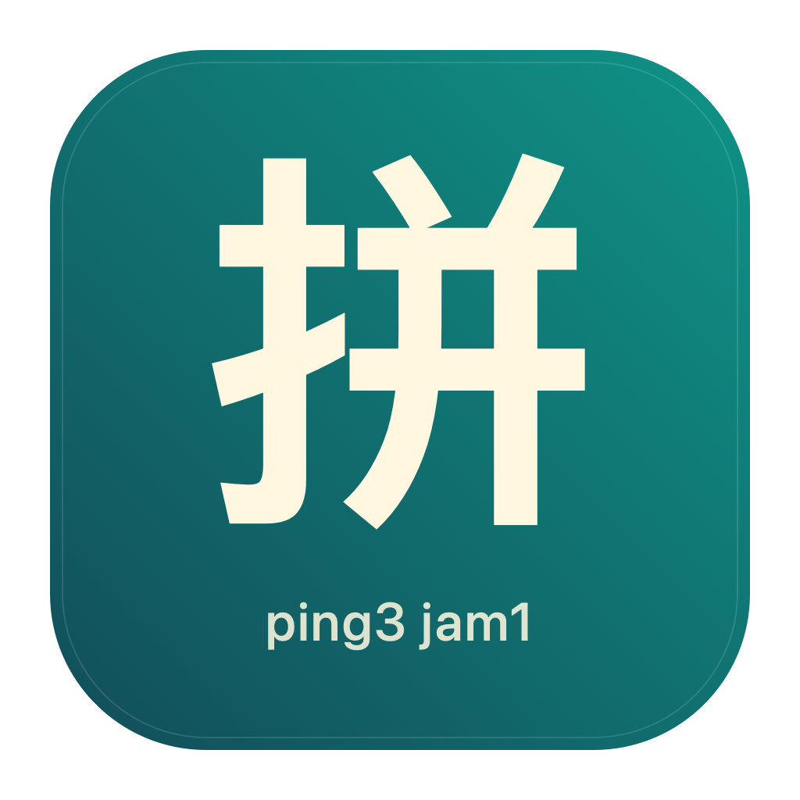

# 拼音字典 · PinyinDictionary



簡單易用的 macOS 離線拼音字典，以 SwiftUI 製作，方便快速查字。支援繁簡體字詞搜尋，提供粵語拼音、粵語同音字、普通話拼音及英文釋義，資料來自 CC-Canto 與 Rime 粵拼詞庫。

## 功能

- **離線查字**：不用帳戶或網路，字典及搜尋索引隨 app 提供。
- **繁簡體搜尋**：輸入中文字、詞語或帶數字聲調的粵拼／普通話拼音，查看詞語建議。
- **讀音與釋義**：顯示粵拼、普通話拼音和 CC-Canto 的原英文釋義；缺少資料時會明確標示。
- **可點擊同音字**：按相同粵拼及聲調配對。點擊後保留該字的搜尋結果，優先開啟符合讀音的真實詞條。
- **清楚的大字介面**：拼音、詞義可選取複製；`⌘F` 可返回搜尋欄。
- **預先建立的索引**：每次輸入不必掃描整份字典，最多列出 100 個建議。

例如：從 `lei4` 的同音字點「麗」，左側保留「麗」的相關詞條，右側會選取「高句麗」（`gou1 ngau1 lei4`），不建立不存在的單字詞條。

## 環境需求

- macOS 13 或以上。
- 開發／編譯：Swift 5.9 或以上，Xcode 15 或以上，或相應版本的 Xcode Command Line Tools。
- 沒有第三方 Swift 套件依賴。編譯腳本只使用 macOS 內建工具及 Swift。

## 建立及執行

在專案根目錄執行：

```sh
./build-app.sh
open dist/拼音字典.app
```

腳本會生成 app 圖示、更新資料授權副本、重新建立索引、編譯目前 Mac 架構的 app，並作本機臨時簽署。產物位於 `dist/`，不會加入版本控制。

也可用 Xcode 開啟 `Package.swift`，選取 `PinyinDictionary` 執行。專案已附上可用索引；若改動原詞表，先執行：

```sh
Tools/build-index.sh
```

## 資料來源及授權

**程式碼與字典資料使用不同授權。**

| 部分 | 提供者 | 授權 |
| --- | --- | --- |
| 原創 Swift 程式碼及工具 | PinyinDictionary contributors | [MIT](LICENSE) |
| CC-Canto，2017-02-02 | Pleco Inc. | [CC BY-SA 3.0](https://creativecommons.org/licenses/by-sa/3.0/) |
| Rime Cantonese words 詞表，2026.08.10 | CanCLID 及貢獻者 | [CC BY 4.0](https://creativecommons.org/licenses/by/4.0/) |
| 合併資料及同音字索引的新增整理貢獻 | PinyinDictionary contributors | [CC BY-SA 4.0](https://creativecommons.org/licenses/by-sa/4.0/) |

完整來源、改動及授權範圍見 [DATA-LICENSE.md](DATA-LICENSE.md)。app 右上方的資訊按鈕亦可查看隨附聲明。MIT 不涵蓋字典資料；原作的授權仍繼續適用於合併資料中的原始內容。

資料來源：[CC-Canto 官方下載](https://cantonese.org/download.html)、[Rime Cantonese](https://github.com/rime/rime-cantonese)、[上游詞表](https://github.com/CanCLID/rime-cantonese-upstream)。本專案不是上述單位的官方產品。

原詞表保留原檔。版本及 SHA-256 校驗值見 [source-manifest.json](Sources/PinyinDictionary/Resources/source-manifest.json)。目前索引共 122,501 個詞條，其中 88,167 個為去重後加入的粵拼補充項目。

## 資料限制

- CC-Canto 以粵語詞彙為主；原書釋義是英文，沒有自動中文翻譯。
- Rime words 詞表只有粵拼，不包含詞義及普通話拼音。本專案不自行補造缺少的內容。
- 原詞表能以繁體或簡體匹配；未包含簡體欄位的補充詞條，不會自動產生簡體轉換。
- 同音字從字數與音節數相同的詞條逐字對齊取得，可能涉及詞中變調，並非完整、獨立校訂的單字讀音表。
- 搜尋以字詞及拼音為準，不搜尋英文釋義；拼音輸入使用數字聲調，例如 `soeng2` 或 `ni3`。

## 驗證

```sh
Tools/verify.sh
```

驗證包括：原詞表校驗值、索引與原資料一致性、248 個查詢與直接搜尋的結果及排序比較，以及全部 13,190 個同音字字音組合的跳轉。效能測量僅供開發參考，不是固定速度保證。

專案採用本機編譯與驗證，沒有設定 GitHub Actions。

## 專案結構

```text
Sources/PinyinDictionary/
  App.swift                 # 搜尋及詞條介面
  Dictionary.swift          # 資料模型、索引與同音字跳轉
  LicensesView.swift        # app 內的來源及授權說明
  Resources/                # 原詞表、來源清單、生成索引及隨附聲明
Assets/                     # app 圖示預覽及 ICNS
Tools/
  MakeAppIcon.swift         # 原創圖示的向量繪製程式
  build-icon.sh             # 重建所有尺寸的 app 圖示
  build-index.sh            # 重新建立資料索引
  verify.sh                 # 執行資料及功能驗證
build-app.sh                # 產生 dist/拼音字典.app
LICENSE                     # 程式碼 MIT 授權
DATA-LICENSE.md             # 資料的獨立授權及署名
```

## 發佈及貢獻

歡迎回報問題或提交 Pull Request，詳見 [CONTRIBUTING.md](CONTRIBUTING.md)。公開來源與 app 前可參考 [PUBLISHING.md](PUBLISHING.md)。提供 app 下載時，請保留完整資源及授權聲明。對外發佈的 app 若需要 macOS 驗證開發者身分，須另作 Developer ID 簽署及 Apple 公證；本機臨時簽署不等於公證。

## App 圖示

青綠色「拼」字及粵拼 `ping3 jam1` 圖示為本專案原創，採 MIT License。`Assets/AppIcon.png` 用於預覽，`Assets/AppIcon.icns` 用於 Finder 和 Dock。圖示也隨 Swift Package 資源提供，直接用 Xcode 執行時會載入。

若想改圖示，可修改 `Tools/MakeAppIcon.swift`，再執行 `Tools/build-icon.sh`；`build-app.sh` 亦會自動重建。圖示沒有使用外部圖片或隨附字型。
